<div align="center">



<a href="https://github.com/LitzyAlex">
  
</a>

<br/>


</div>

<br/>



```yaml
name:        Litzy
class:       Aspiring Developer 🧙‍♀️
favorite:    Games 🎮
engine:      Unity
guild:       Game Jams
status:      Online ✨
```

| 🎯 Stat | Detail |
|:--|:--|
| 🔭 **Main quest** | [**HERA**](https://github.com/OctavioNovelo/Herramientas-Ejecutables-de-Reconocimineto-y-Auditoria) — executable reconnaissance & auditing tools |
| 🌱 **Skill tree** | Currently unlocking **C#** |
| 💬 **Ask me about** | **Games** — design, jams, Unity, shaders, anything! |
| 📫 **Send a message** | [litzyrichaud@gmail.com](mailto:litzyrichaud@gmail.com) |
| ⚡ **Fun fact** | The first famous video game Easter egg was hidden in Atari's *Adventure*. 🥚 |

> *Every bug is a side quest. Every fix is XP.*

<br/>



<table>
<tr>
<td width="50%" valign="top">

### 🏢 Another Day

**Unity 2D · C# · Game Jam 2026**

A game about workplace burnout and mental health, exploring the pressure of office routines through gameplay.

**Current development includes:**
- Mission and task management systems.
- Interactive environments and character movement.
- Timed objectives, UI feedback, and progression.
- Audio, animations, and scene transitions.

[](https://github.com/LitzyAlex/VideoGames/tree/main/GameJam%20Anahuac%202026/AnotherDay)

</td>
<td width="50%" valign="top">

### 🛡️ HERA

**Network Auditing · Desktop UI · Team Project**

A tool designed to make network auditing more accessible by organizing scan execution and presenting results through a graphical interface and command-line workflow.

**My focus:**
- Contributing to the frontend.
- Building and connecting interface components.
- Working with a team on a security-oriented application.

[](https://github.com/OctavioNovelo/Herramientas-Ejecutables-de-Reconocimineto-y-Auditoria)

</td>
</tr>
<tr>
<td width="50%" valign="top">

### 🎭 Cursed Mask

**Global Game Jam 2025**

A game-jam project developed as part of my game development journey.

I'm keeping this project alongside my other game experiments to document my progress and experience with collaborative game creation.

[](https://github.com/LitzyAlex/VideoGames/tree/main/Global%20GameJam%202025/Cursed%20Mask)

</td>
<td width="50%" valign="top">

### 📚 University Projects

**C# · .NET · Data Structures**

A collection of academic projects and programming exercises developed throughout my studies.

**Topics include:**
- Stacks, queues, and other data structures.
- Object-oriented programming.
- Calculator implementations and algorithms.
- C# and .NET fundamentals.

[](https://github.com/LitzyAlex/Universidad-Modelo-DTS)

</td>
</tr>
</table>


</div>

### 🎮 VideoGames `⚔️ Main Campaign`
My game development hub, built with **Unity**. Everything I make while learning how games come to life lives here:

- 🏆 **[GameJam Anahuac 2026 — *AnotherDay*]** — game made for the Anáhuac game jam.
- 🎭 **[Global Game Jam 2025 — *Cursed Mask*]** — my entry for the Global Game Jam 2025.
- 🧪 **[Tutoriales y Pruebas]** — the training room: tutorials, experiments and prototypes.

### 🎓 Universidad-Modelo-DTS `📚 Side Quest`
School projects and assignments from university, written mostly in **C++, C# and Python**.

### 🔭 HERA `🔥 Currently Active`
**H**erramientas **E**jecutables de **R**econocimiento y **A**uditoría — the project I'm working on right now, mostly written in **Lua**.

<br/>



<div align="center">

### Languages


### Game Development


### Tools & Frameworks


</div>

<br/>



<div align="center">


</div>

<br/>


<br/><br/>




<div align="center">

[](mailto:litzyrichaud@gmail.com)
[](https://github.com/LitzyAlex)


</div>

>*Sometimes the best discoveries are the ones hidden in the code.*


